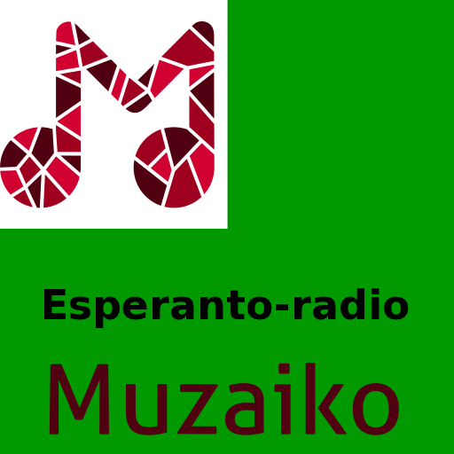
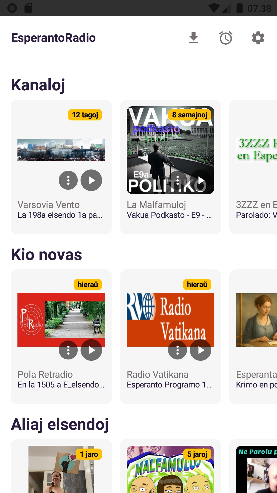
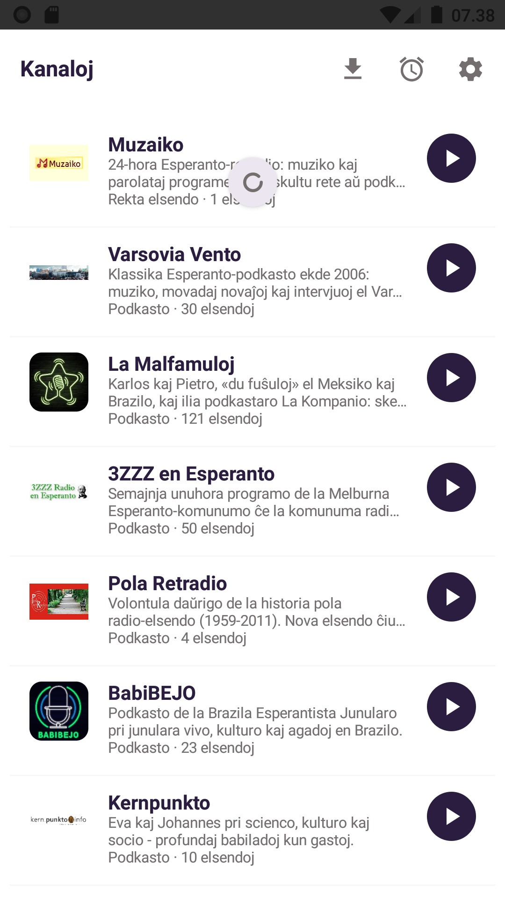
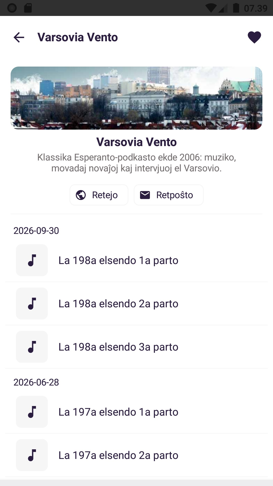
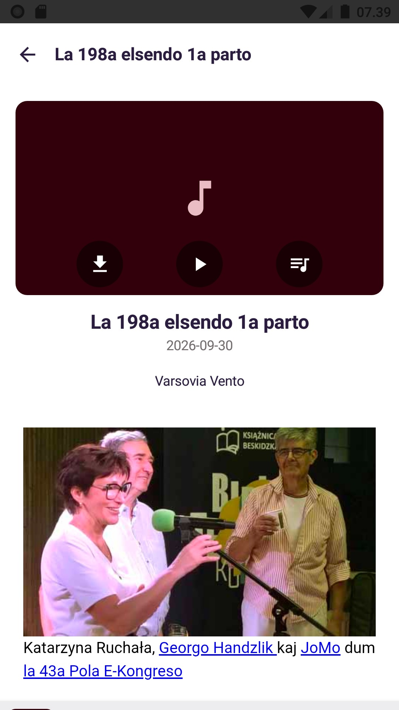
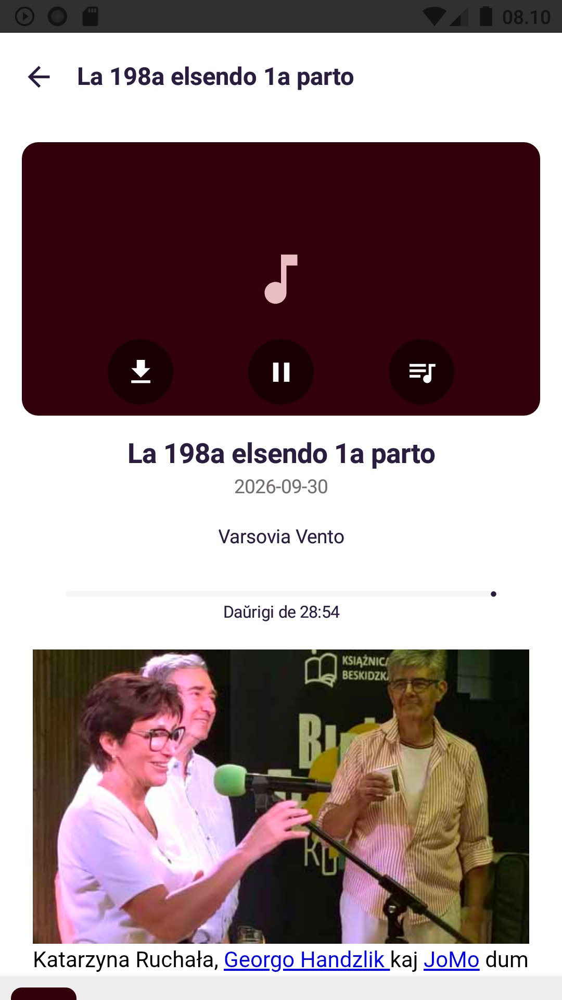
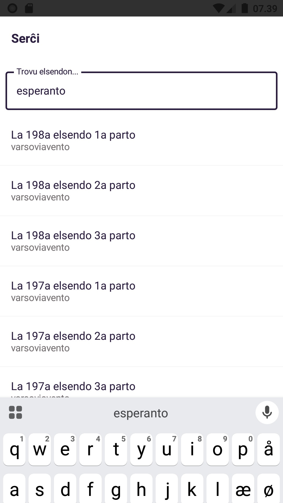
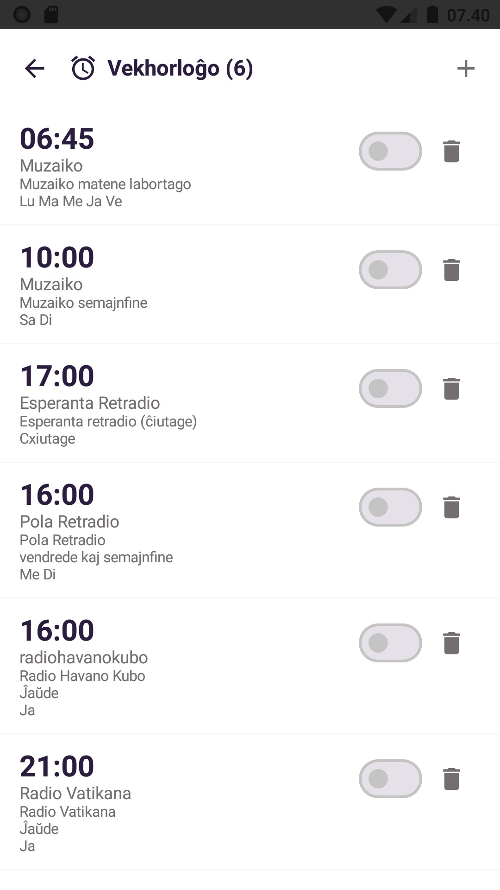
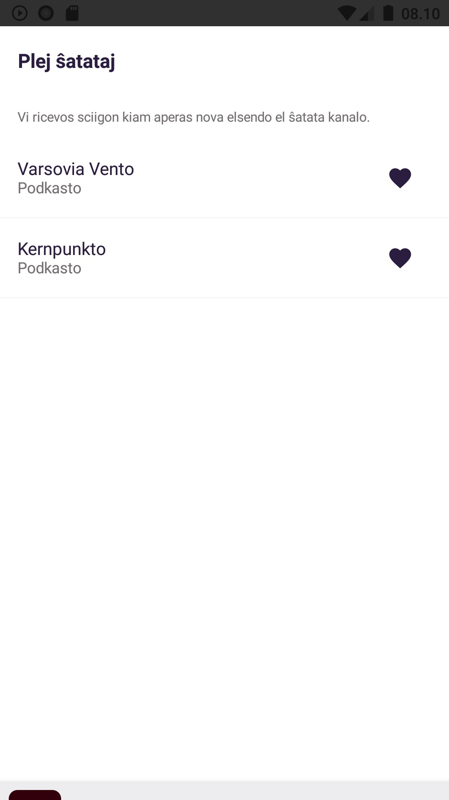
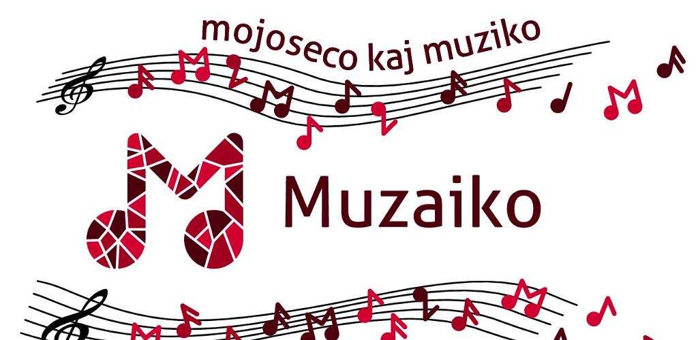

<p align="center">
  
</p>

<h1 align="center">EsperantoRadio</h1>

<p align="center">
  <b>Radio kun 27 Esperanto-kanaloj kaj podkastoj, el la tuta mondo.</b><br/>
  Unu apo por ĉiuj — poŝtelefono, komputilo kaj retumilo.
</p>

<p align="center">
  <a href="https://play.google.com/store/apps/details?id=dk.nordfalk.esperanto.radio"></a>
  <a href="LICENSE"></a>
  
</p>

## Aŭskultu Esperantan radion

27 radiokanaloj kaj podkastoj en Esperanto el la tuta mondo - en unu apo.

📻 KANALOJ
- [Esperanta Retradio](https://aldone.de/retradio) — ĉiutagaj «sonartikoloj» por lernantoj
- [Varsovia Vento](https://podkasto.net/) — klasika Esperanto-podkasto ekde 2006: muziko, novaĵoj kaj intervjuoj el Varsovio
- [Pola Retradio](https://pola-retradio.org/) — daŭrigo de la historia pola radio-elsendo (1959–2011)
- [3ZZZ en Esperanto](https://melburno.org.au/3ZZZradio/) — semajnja programo de la Melburna Esperanto-komunumo
- [Kernpunkto](https://kern.punkto.info/) — scienco, kulturo kaj socio kun Eva kaj Johannes
- [Movada Vidpunkto](https://movada-vid.punkto.info/) — intervjuoj pri la Esperanto-movado
- [Radio Scienca](https://www.radioscienca.com/) — sciencaj temoj klarigitaj en Esperanto
- [Radio Vatikana](https://www.radio-vatikana-esperanto.org) — novaĵoj pri la Papo kaj la Eklezio (ekde 1977)
- [La Malfamuloj](https://www.patreon.com/lakompanio) — skeĉoj, «Mondaj Sekretoj» kaj «Mitoj» el Meksiko kaj Brazilo
- [BabiBEJO](https://bejo.esperanto.org.br/babibejo) — podkasto de la Brazila Esperantista Junularo
- [Muzaiko](https://muzaiko.info/) — 24-hora Esperanto-retradio: muziko kaj parolataj programeroj
- [Internacia Afrika Retradio](https://internaciaretradio.wordpress.com/) — novaĵoj kaj kulturo el Afriko
- [Fremdulo 3](https://tkubisiowski.eu/fremdulo) — podkasto pri movado, lingvoj kaj transporto
- [Usone Persone](https://usonepersone.substack.com) — literaturo, politiko kaj movado el Usono
- [Ne Parolu pri Esperanto](https://www.spreaker.com/show/neparolupriesperanto) — amuzaj klarigoj pri ĉio ajn
- [Radikala tenero](https://radikalatenero.substack.com) — feminismaj babiladoj
- [Esperanto Stories](https://esperantostories.carrd.co) — mallongaj rakontoj por lernantoj, kaj en Esperanto kaj en la angla
- [Le Monde diplomatique en Esperanto](https://shows.acast.com/diploesperanto) — voĉlegitaj artikoloj
- [Rakonta Tempo](https://podcasters.spotify.com/pod/show/au016dsteno) — noveloj kaj fabeloj voĉlegate
- [Esp. Magazino Tuluzo](https://toulouse.occeo.net/eo/radio/) — magazino de Tuluzo, parte en Esperanto
- [Spiritisma Voĉo](https://www.spreaker.com/user/8650988) — voĉlegitaj spiritismaj tekstoj el Brazilo
- [Vinilkosmo](https://www.vinilkosmo-mp3.com/index.php?language=eo) — novaĵoj kaj muziko de la Esperanto-muzikeldonejo
- [Bitmono](https://anchor.fm/bitmono) — bitmono kaj kriptovalutoj simple klarigitaj
- [Pri Sano](https://anchor.fm/miapodkastoprisano) — sanaj temoj kaj ĉiutaga bonfarto
- [Radio Frei](https://www.radio-frei.de/index.php?iid=podcast&ssuchtext=esperanto) — Esperanto-podkastoj de germana libera radio
- [Kaliningrada E-radio](https://radio.esperanto-ondo.ru/) — sonprogramoj el Kaliningrado, Rusio
- [Universeala Lindo](https://universealalindo.wordpress.com/) — argentina podkasto pri Esperanto

## Ekranfotoj

| | | | |
| :---: | :---: | :---: | :---: |
|  |  |  |  |
|  |  |  |  |

## Funkcioj

- **Kanalaro** — superrigardo de ĉiuj kanaloj kun tuja elsendfluo kaj arkivitaj elsendoj
- **Podkastoj** — esploru elsendojn, aŭskultu tuj aŭ elŝutu por aŭskulti eksterrete
- **Sciigoj** — marku ŝatatajn kanalojn per ❤️ kaj ricevu sciigon, kiam nova elsendo disponiĝas
- **Serĉo** — tra ĉiuj kanaloj samtempe
- **Vekhorloĝo** — vekiĝi ⏰ per via preferata kanalo
- **Ludvico** — metu elsendojn en vicon ▶️, mini-ludilbreto ĉiam videbla
- **Elŝutoj** ⬇️ — aŭskultado ankaŭ eksterrete
- **Libera programaro** 🔓 — laŭ la GPL-3.0-permesilo

Bonvolu raporti problemojn kiel [issue](https://github.com/nordfalk/EsperantoRadio/issues).


## Elŝuti

| De kie | Ligilo |
|---|---|
| Google Play | <https://play.google.com/store/apps/details?id=dk.nordfalk.esperanto.radio> |
| GitHub-releases | <https://github.com/nordfalk/EsperantoRadio/releases> |

Konstruu mem: `./gradlew :androidApp:assembleDebug` (JDK 17 necesas).

## Dokumentaro

| Se vi volas vidi...         | Legu |
|-----------------------------|---|
| Arkitekturon kaj datenfluon | [`docs/nova/INDEKSO.md`](docs/nova/INDEKSO.md) |
| La parsadon de radiaj fluoj | [`docs/nova/04_parsado_kaj_arkivo.md`](docs/nova/04_parsado_kaj_arkivo.md) |
| Dizajnon kaj UI             | [`docs/nova/05_dizajno_kaj_ui.md`](docs/nova/05_dizajno_kaj_ui.md) |
| Gvidliniojn por agentoj     | [`AGENTS.md`](AGENTS.md) |
| Protokolaron                | [`NOTOJ.md`](NOTOJ.md) · [`CHANGELOG.md`](CHANGELOG.md) · [`ŜANĜOJ.md`](ŜANĜOJ.md) |
| Malfermajn taskojn          | [`FAROTA.md`](FAROTA.md) |

## La arkivo de elsendoj

Por konstrui arkivon de Esperanto-elsendoj, mi uzas

```bash
./gradlew clean
./gradlew :parse:rssarkivserverJar
java -jar malnova/parse/build/libs/rssarkivserver.jar
```

## Permesilo kaj historio

La apo estas libera programaro laŭ la **GPL-3.0**-permesilo — vidu [`LICENSE`](LICENSE).

EsperantoRadio estis origine en 2015 forko de la dana ŝtata **DR Radio**-apo, kiun la aŭtoro tiam prizorgis.
Tiu versio troviĝas nun en la dosierujo [`malnova/`](malnova/).

La nova versio estas plene farita per [Mistral Vibe](https://mistral.ai/products/vibe/).
Vi povas vidi la historiajn komandojn al Vibe ĉi tie: [docs/historio.html](https://nordfalk.github.io/EsperantoRadio/historio.html)

La apo daŭre tenas la ruĝan M de la iama kanalo Muzaiko en la emblemo kaj daŭre povas ludi la rektan elsendon de Muzaiko
(kiu nun elsendas nur Esperanto-muzikon el la arkivo, sen veraj programeroj).

### Muzaiko - kio estis?
La apo estis farita kunlabore kun [Muzaiko](https://muzaiko.info/) — tuttempa interreta radiostacio en Esperanto.
La ideo de Muzaiko naskiĝis en aprilo 2011 dum la Brita Kongreso de Esperanto (ĉefa antaŭenigantino: la hungarino Veronika Poór),
kaj ekde la 1-a de julio 2011 ĝi elsendis muzikon, mondajn novaĵojn (ĉiuhore) kaj parolatajn programerojn,
produktatajn de volontula internacia teamo de junaj esperantistoj.

<p align="center">
  
</p>
Post jardeko la energio iom post iom malaperis. En aprilo 2022 Muzaiko ĉesis siajn regulajn elsendojn.

Legu pli ĉe Vikipedio: [Muzaiko](https://eo.wikipedia.org/wiki/Muzaiko)

# Dansk
App'en er open sourpuce under GPL licensen og kan findes på https://github.com/nordfalk/EsperantoRadio

EsperantoRadio bygger på arbejde på DR Radio lavet af Lund&Bendsen for DR.
Det oprindelige arbejde ligger på https://github.com/androidlundogbendsen/dr-radio-android.
GPL licensen som DR Radio blev publiceret under kan læses her https://github.com/androidlundogbendsen/dr-radio-android/blob/master/DRRadiov2/LICENSE.txt

